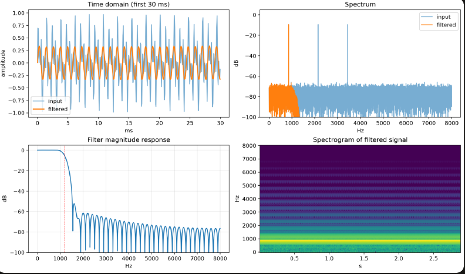

# SignalLab: digital signal processing toolkit
   

   [Full project report (PDF)](SignalLab_README.pdf)

Generate or upload audio, add noise, design FIR/IIR filters and see the result.

## Run
    pip install -r requirements.txt
    streamlit run app.py
    python -m pytest          # runs the DSP tests

## Features
- Signals: sine, square, sawtooth, chirp, multi-tone, or your own WAV file
- Noise at any SNR (dB), with measured SNR before and after filtering
- Filters: lowpass / highpass / bandpass / bandstop using FIR (window), Butterworth,
  Chebyshev I and Elliptic designs, with a stability check and zero-phase option
- Plots: time domain, spectrum, filter magnitude response, spectrogram
- Download and play the filtered WAV

## Files
- dsp.py       core DSP functions (no UI)
- app.py       Streamlit interface
- test_dsp.py  pytest tests for filters, SNR, FFT peaks and WAV I/O

## Ideas to extend
Pole-zero plot, real-time microphone input, ECG/EEG denoising demo, adaptive (LMS) filter,
FIR design with Kaiser or Parks-McClellan, deploy free on Streamlit Community Cloud.

[Full project report (PDF)](SignalLab_README.pdf)

[Try the live app](https://signal-lab007.streamlit.app)
